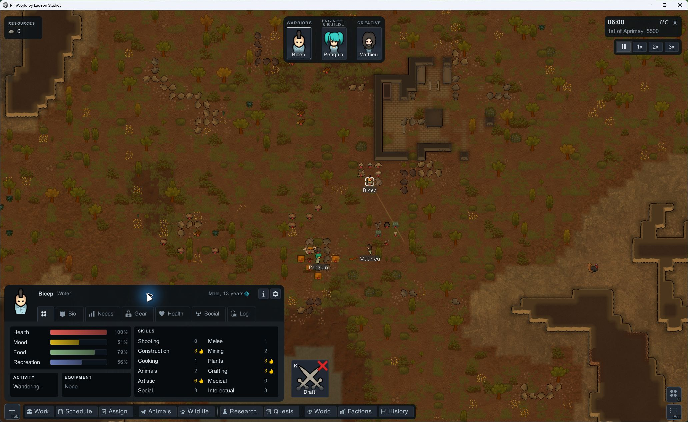
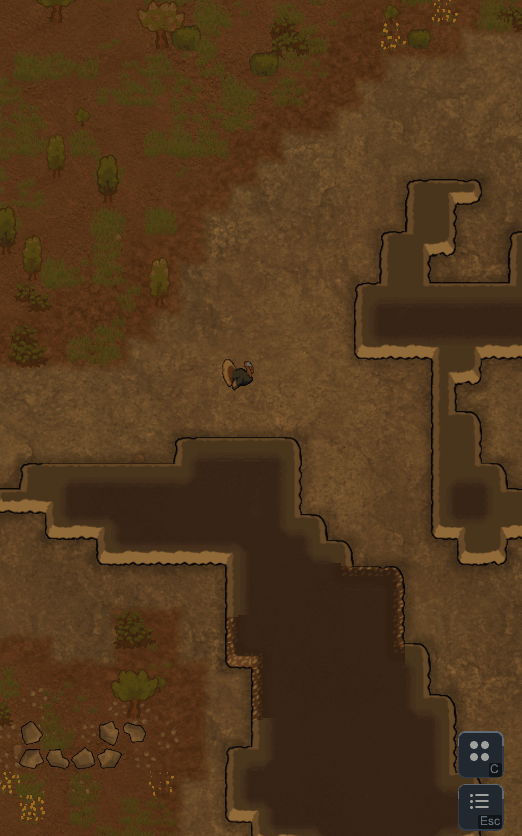
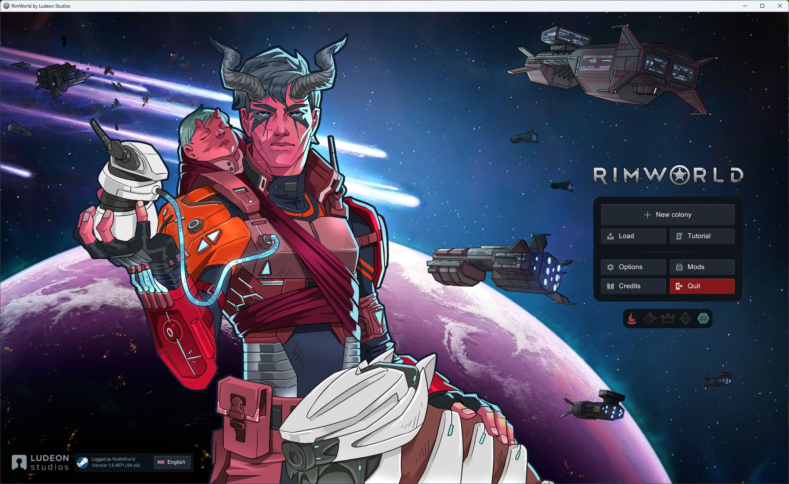
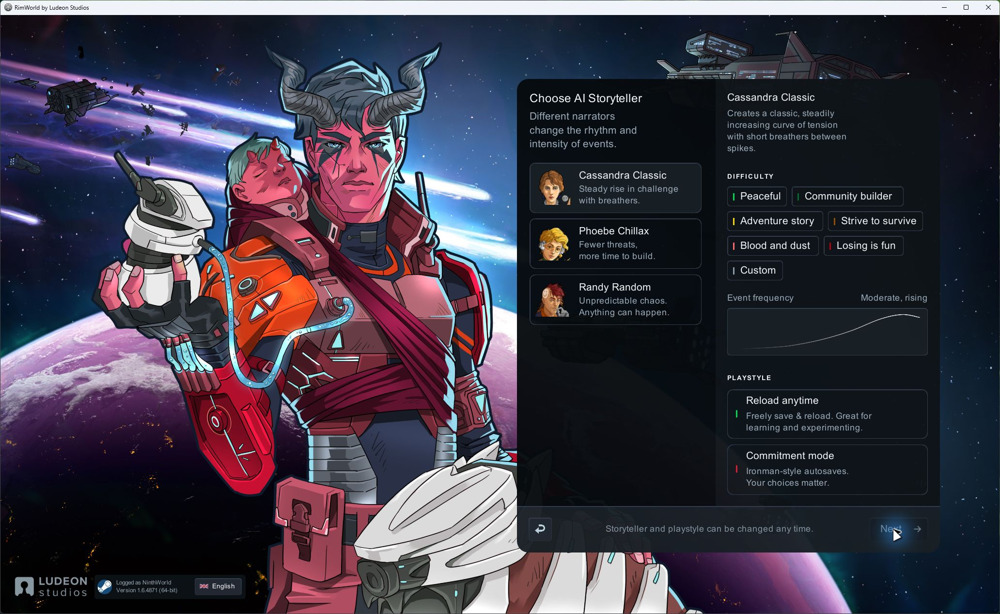
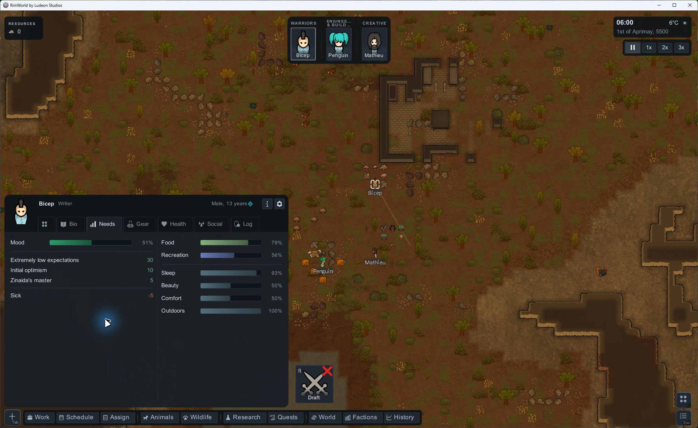
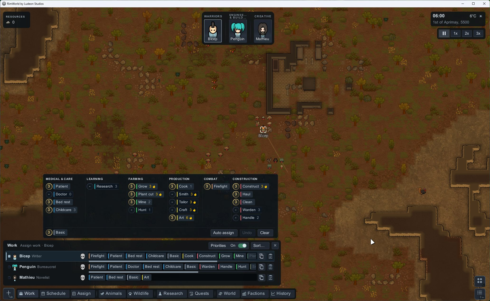
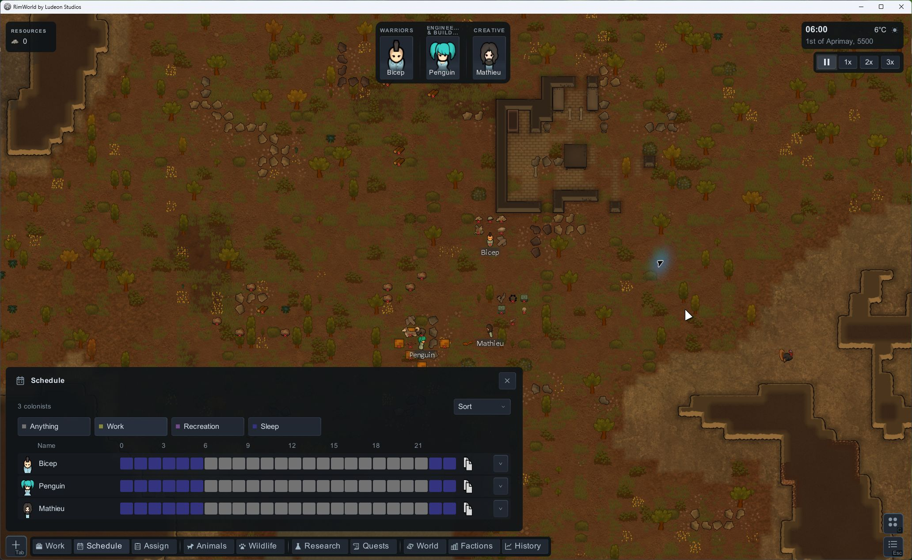
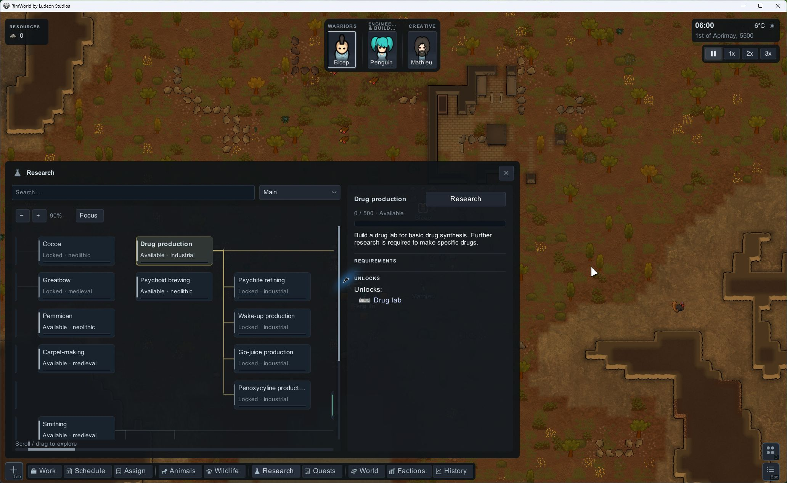

<p align="center">
  
</p>

<p align="center">
  <strong>A clearer view of your colony.</strong><br>
  Compact controls, readable pawn information, and a cohesive new interface for RimWorld.
</p>

<p align="center">
  <kbd>RimWorld 1.6</kbd> · <kbd>v0.23.1</kbd> · <kbd>In development</kbd> · <kbd>Harmony required</kbd>
</p>

<p align="center">
  <a href="#showcase">Showcase</a> ·
  <a href="#try-the-mod">Try the mod</a> ·
  <a href="#roadmap">Roadmap</a> ·
  <a href="#development">Development</a>
</p>

**RimWorld Reframed** (shown in game as **Reframed UI**) is a UI overhaul that brings the colony's people, work, resources and decisions into compact, consistent panels. It reworks everyday screens around clear typography, grouped information, dark translucent surfaces and animated transitions, while keeping RimWorld's native systems and actions accessible.

The project is inspired by [RimWorld UI Reworked by yarich SA](https://www.behance.net/gallery/232485291/RimWorld-UI-Reworked), with an independent implementation and extensions for screens beyond the concept.

## Showcase

**Your colony, at a glance.** Portrait cards, a compact navigation dock, separate time controls, and a pawn overview with needs, skills and equipment in one place.



### Animated panels

<p align="center">
  
</p>

*A real opening and closing sequence from the Tools panel. The loop includes pauses so you can inspect the expanded UI. [Capture details and still images](Docs/Showcase/README.md).*

### From starting a colony to managing it

Click a screenshot to see it at full size. All screenshots below show the installed **v0.23.1** mod, captured on **19 October 2026**.

<table>
  <tr>
    <td width="50%">
      <strong>A new front door</strong><br>
      A compact main menu over RimWorld's own background artwork.<br><br>
      <a href="Docs/Showcase/main-menu.jpg"></a>
    </td>
    <td width="50%">
      <strong>Choose your story</strong><br>
      Storyteller cards, difficulty choices and a conceptual rhythm guide.<br><br>
      <a href="Docs/Showcase/storyteller.jpg"></a>
    </td>
  </tr>
  <tr>
    <td>
      <strong>Understand your colonists</strong><br>
      Needs, mood effects and related information in a readable inspector.<br><br>
      <a href="Docs/Showcase/pawn-needs.jpg"></a>
    </td>
    <td>
      <strong>Make work readable</strong><br>
      Compact work tags, optional numeric priorities and a focused assignment panel.<br><br>
      <a href="Docs/Showcase/work.jpg"></a>
    </td>
  </tr>
  <tr>
    <td>
      <strong>Plan the day</strong><br>
      A colored timetable with compact colonist rows and copy controls.<br><br>
      <a href="Docs/Showcase/schedule.jpg"></a>
    </td>
    <td>
      <strong>See what comes next</strong><br>
      A searchable research graph with linked projects, requirements and unlocks.<br><br>
      <a href="Docs/Showcase/research.jpg"></a>
    </td>
  </tr>
</table>

### More of the interface, brought together

| Area | What Reframed adds |
|---|---|
| Colony HUD | Portrait cards, expandable resources and trends, a compact dock, clock and speed controls. |
| Pawn inspection | Redesigned Overview, Bio, Needs, Gear, Health, Social and Log panels, plus information cards. |
| Colony management | Work tags and priorities; compact Schedule, Assign, Animals and Wildlife views. Work's Auto assign, Clear and Undo act on the selected pawn. |
| Research and records | Research dependencies, quest details, faction information and History charts. |
| Building and navigation | Redesigned Architect, map search, Tools and Esc menus; adapted World HUD and inspector framing. |
| Alerts and notifications | Grouped colony issues, critical alerts, notification cards and research-completion UI. |
| Starting and loading | Main menu, save browser, scenario selection, storyteller selection and world-creation settings. |

## Try the mod

**This repository currently provides development source.** Downloading its ZIP does not give you a compiled, ready-to-enable mod. Build a runtime package using the instructions below, or use a separately supplied runtime package.

1. Install **RimWorld 1.6** and the **Harmony** mod (`brrainz.harmony`).
2. Put the runtime package under RimWorld's `Mods` folder. It must contain `About`, `Assemblies`, `Defs`, `Patches` and `Textures`.
3. Enable **Harmony** before **Reframed UI** (`chris.reframedui`) in the mod list.
4. Restart RimWorld after installing or updating the DLL.

The runtime is developed and tested on **Windows**. Broad mod/DLC compatibility and other operating systems are still being evaluated. Use a disposable colony or a backed-up save when trying a development build.

## Roadmap

Reframed is actively in development, with more UI still to cover. Some dialogs and DLC destinations retain native layouts; opening/closing motion, transparency, localization and small-screen behavior still need work across older surfaces. A missing-controls issue in the Reframed settings panel is also tracked.

The [remaining UI audit](Docs/UI-Reworked/Audit32/README.md) organizes this work into a [35-group TODO list](Docs/UI-Reworked/Audit32/ui-todo.csv), including settings, storage and bills, policies, trade/caravan flows, secondary panels and compatibility. Screenshots illustrate the shown states; they do not imply that every window has been redesigned.

[Report a UI gap or bug](https://github.com/ninthworld/RimWorldReframed/issues/new/choose) · [Help develop the mod](CONTRIBUTING.md)

## Development

Use a **.NET 10 SDK**, PowerShell, Python 3, and your own RimWorld 1.6 installation on Windows. `global.json` accepts stable 10.0 feature bands from 10.0.100 onward. Game/Unity DLLs are referenced locally; NuGet supplies the compile-time Harmony 2.3.6 and .NET Framework reference assemblies.

```powershell
# Build privately, then stage a runtime package.
.\Build.ps1 -RimWorldDir 'D:\Games\RimWorld' -OutputDir 'work\private-build'
python Tools/package-mod.py --assembly work/private-build/ReframedUI.dll --output artifacts/player-package

# Run the 31 game-independent test suites.
pwsh -File Tools/Test.ps1
```

`RIMWORLD_DIR` can replace `-RimWorldDir`; `-ManagedDir` overrides the managed assembly location. Without `-OutputDir`, `Build.ps1` writes directly to this checkout's **Assemblies** directory. Restart the game after an intentional deployment.

[Pure-contract CI](https://github.com/ninthworld/RimWorldReframed/actions/workflows/pure-tests.yml) uses the same test runner on Windows and Linux. It does not build the game-dependent mod or establish in-game compatibility. See [CONTRIBUTING.md](CONTRIBUTING.md) for native checks, UI testing and the contribution workflow, and the [repository policy](Docs/UI-Reworked/07-github-readiness.md) for source/package boundaries.

## Credits and license

Design inspiration: **[yarich SA — RimWorld UI Reworked](https://www.behance.net/gallery/232485291/RimWorld-UI-Reworked)**. Reframed is independently implemented and is not affiliated with the concept designer or Ludeon Studios.

Original code, documentation and original authored assets, including the Reframed logo, use the [MIT license](LICENSE). RimWorld artwork shown in gameplay captures belongs to its respective rights holders and is not covered by that grant. See [third-party notices](THIRD_PARTY_NOTICES.md) and [showcase provenance](Docs/Showcase/README.md).
